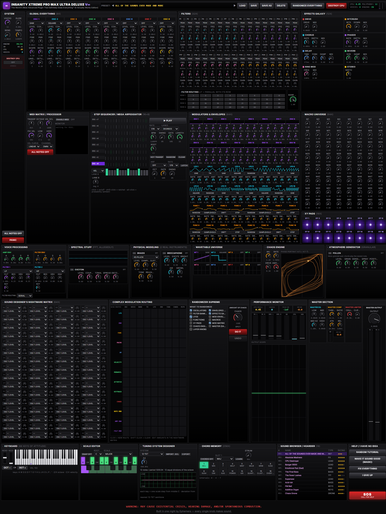

# INSANITY XTREME PRO MAX ULTRA DELUXE v∞ (It Actually Works Edition)

> **Original concept by [u/PoloVG](https://www.reddit.com/user/PoloVG/).**
> This synth exists because of [his post on r/FREEVSTS](https://www.reddit.com/r/FREEVSTS/comments/1xmfrz4/insanity_xtreme_pro_max_ultra_deluxe/).
> The name, the front panel and the DESTROY CPU button are all his idea. We just wired it up.

A browser synth with 799 parameters, and every single knob makes sound.



**[Try it in your browser](https://creeptones.github.io/insanity-xtreme/)** (needs Web Audio; Web MIDI is optional).

## How this happened

[u/PoloVG posted a joke on r/FREEVSTS](https://www.reddit.com/r/FREEVSTS/comments/1xmfrz4/insanity_xtreme_pro_max_ultra_deluxe/)
about the wave of AI-made plugins. It was an
AI-generated screenshot of a plugin that does not exist, with hundreds of knobs,
a "DESTROY CPU" button and a name that keeps on going. The link to the "detailed
presentation" was a rickroll.

It was a good joke. It was also, unfortunately, a spec.

The Ephemera dev built it the same night. This version keeps the same absurd
front panel, except every knob is wired to real DSP running in an AudioWorklet.
It is Ephemera's first open-source instrument, and it is free. Never gonna give
you up.

## What's inside

All of it is real and all of it is playable.

**Voices**

- 16 voices, each with 8 oscillators.
- Oscillator modes: sine, triangle, saw, square, noise, wavetable (band-limited),
  FM, additive and chaos (a Van der Pol oscillator). Each oscillator has level,
  coarse, fine, pan, shape, ratio, up to 8x unison and detune.
- Amp and filter ADSR envelopes per voice.
- Two state-variable filters per voice (LP, HP, BP, notch), in series or parallel,
  with drive, envelope amount and keytracking. Glide and pitch-bend range.

**Filter bank**

- 32 bus filter bands (peak, LP, HP, BP, notch), laid out as 4 rows of 8.
- A routing grid puts each band in series or in parallel with its row.
  Band changes crossfade, so nothing clicks.

**Modulation**

- 64-slot mod matrix, with 153 sources and 335 destinations.
- 16 LFOs (sine, triangle, saw, square, random).
- 16 ADSR mod envelopes.
- 16 function generators (random, sample-and-hold, drift, step).
- 64 macros and 16 XY pads, all usable as mod sources.
- A Van der Pol chaos engine as a mod source.
- Velocity, mod wheel, aftertouch, keytrack, per-note random and the amp and
  filter envelopes are sources too.

**Effects and master**

- Effects chain: drive, bitcrusher, ring mod, phaser, chorus, ping-pong delay,
  an 8-line FDN reverb and stereo width.
- Master chain: 3-band EQ, compressor, clipper, output volume and a lookahead
  brickwall limiter. Live meters, a scope and a CPU readout.

**Performance**

- Arpeggiator (up, down, up-down, down-up, random, as played).
- 16-step, 8-lane step sequencer with per-step velocity, probability and ratchets.
- Web MIDI input, with a MIDI matrix for transpose, octave, velocity curve,
  channel filter and key range. The start screen lets you pick a MIDI keyboard
  or your PC keyboard. If you allowed MIDI on an earlier visit, a plugged-in
  keyboard connects by itself, and hot-plugged devices are picked up live.
- Chord memory, scale snap and a scale editor.
- Microtuning: load and save Scala `.scl` files, plus EDO and other tuning presets.
- On-screen keyboard with pitch-bend and mod-wheel strips.
- Play from your computer keyboard: `A W S E D F T G Y H U J K O L P ; '` are
  notes, `Z`/`X` shift the octave, `C`/`V` change velocity.

**Layers**

Four extra instruments can be layered under the synth. They feed the same
filter bank, effects and master.

- Braids: 5 physical models (Karplus-Strong pluck, modal bell, FM reed, bowed
  string, breath pad).
- Breezaphone: an aerophone waveguide lead.
- Pollen: a granular engine.
- Exciton: a coupled-resonator lattice synth.

**ONE PAGER**

Don't need all 799? Hit **✦ One Pager** for the stripped-down view: two
oscillators, a big filter with a cutoff × resonance pad, the amp envelope drawn
live, effects, master, a glowing scope and the keyboard, all on one screen.
Same engine and sound; **Full Insanity →** takes you back. Short laptop screens
get the page scaled to fit; phones get the cards stacked.

**On phones**

Below 1024px the page becomes one long scroll. Every section is a tab you can
close to its title bar and reopen; a sticky bar jumps to any section, the
keyboard stays pinned to the bottom, and knobs grow to finger size. The
essentials start open and your choices are remembered.

**Everything else**

- 18 factory presets, including "Make It Sound Good™".
- User presets, saved in your browser.
- A randomizer, per section or all at once.
- The DESTROY CPU button. It forces 8x unison on every active oscillator.
  It does what it says.

## Development

You need Node 20.19 or newer.

```sh
npm install
npm run dev            # build the worklet, then start Vite at http://localhost:5173
npm run build          # build the worklet, then build the site into dist/
npm run preview        # serve dist/ locally
npm test               # pure-logic tests: Scala parser, tuning, scale snap, arp, MIDI matrix
npx tsc --noEmit       # typecheck
npm run build:worklet  # rebuild only the AudioWorklet bundle
```

The site is served from `/` by default. To build for a subpath, set `BASE_PATH`:

```sh
BASE_PATH=/insanity-xtreme/ npm run build
```

The GitHub Pages workflow in `.github/workflows/pages.yml` does exactly that on
every push to `main`.

## Architecture

```
src/
  main.tsx                     Vite entry; mounts the page
  lib/insanity/
    params.ts                  the parameter table (single source of truth)
    protocol.ts                messages between the page and the worklet
    host.ts                    page-side engine: AudioContext, worklet node, param store
    presets.ts, randomize.ts   factory and user presets, the randomizer
    perf/                      MIDI, arp, sequencer, chords, scales, tuning
    layers/                    the Braids, Breezaphone, Pollen and Exciton layers
  lib/workletUrl.ts            builds worklet URLs from Vite's base URL
  worklets/insanity/           the DSP, bundled into public/worklets/insanity-engine.js
  components/insanity/         React UI (panels, knobs, performance controls)
public/worklets/               AudioWorklet scripts loaded at runtime
scripts/build-worklet.mjs      esbuild bundler for the worklet
```

**`params.ts` is the single source of truth.** Every parameter has an id, a
label, a range, a default and a skew. A parameter's index is its position in
the `PARAMS` list, and that index is what travels to the worklet. The page, the
worklet and the presets all read this one file. It is plain TypeScript with no
DOM or React, so the worklet bundle imports it too.

**`protocol.ts`** defines the messages. The page sends `setAll`, sparse `params`
batches, `noteOn`, `noteOff`, `panic`, `allNotesOff` and `controller`. The worklet
sends a `meters` report about 30 times a second. Like `params.ts`, it is pure
and is bundled into the worklet.

**`host.ts`** owns the AudioContext and the worklet node. `setParam` updates the
UI store immediately and queues the value. Queued values go to the worklet once
per animation frame. Notes fan out to the worklet voices and to any active layer.

**The worklet** (`src/worklets/insanity/`) runs everything on the audio thread.
`index.js` is the processor. `voices.js` and `osc.js` are the voice pool and
oscillators. `modSources.js`, `modMatrix.js` and `chaos.js` handle modulation.
`bus.js` runs `filterBank.js`, then `fxChain.js`, then `master.js`. `pidx.js`
looks up parameter indexes by id at load, so reordering `params.ts` cannot
misalign the engine. Nothing allocates after construction.

An AudioWorklet cannot `import`, so `scripts/build-worklet.mjs` bundles the
worklet sources into one classic script. The generated
`public/worklets/insanity-engine.js` is committed, so a fresh checkout runs
without a build step. Do not edit it by hand.

### Adding a parameter

1. Declare it in `src/lib/insanity/params.ts` with `cont`, `int`, `en` or
   `bool`, in its section and before the mod-slot block at the end. Continuous
   engine parameters become mod-matrix destinations automatically.
2. Read it in the worklet. Add its index to `pidx.js` (or call
   `paramIndex("your.id")` in the bus modules) and use the value in the DSP.
3. Put a control on a panel: `<ParamKnob id="your.id" />`, `<ParamToggle>` or
   `<ParamSelect>` from `components/insanity/InsanityKnob.tsx`.
4. Run `npm run build:worklet` (or just `npm run dev`).

User presets store values by index. Adding a parameter shifts every index after
it, and adding a modulatable one also shifts the mod-matrix destination list.
Presets saved before the change will load slightly wrong.

### Vendored worklets

The layer instruments load prebuilt scripts from `public/worklets/`.
`braids-*.js`, `breezaphone-engine.js` and `exciton-engine.js` are hand-written
worklets. `pollen-engine.js` is a prebuilt, unminified esbuild bundle of the
Pollen engine, vendored as-is; its source tree is not part of this repo. All of
them are by the same author and are covered by the same MIT license.

## Made by Ephemera

INSANITY XTREME is a gift from [Ephemera](https://ephemera.fm).

## License

MIT. See [LICENSE](LICENSE).
